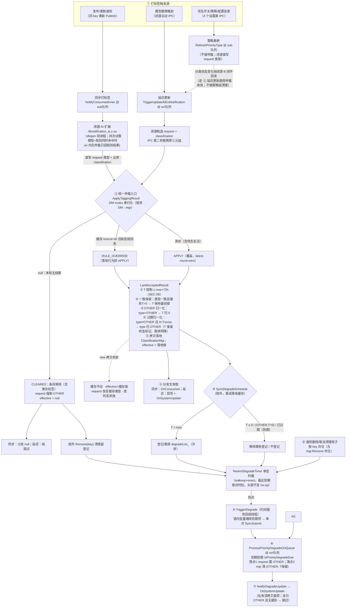
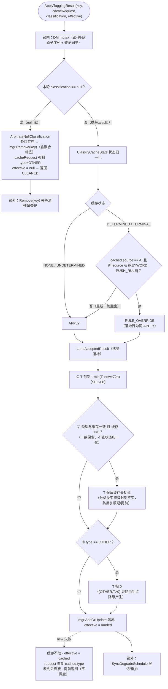
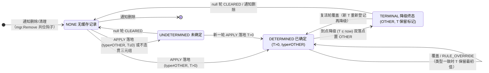

# Design - 优先通知降级（priority-notification-degrade）

> 状态：特性已实现交付（提交 f02ebafc）；仲裁终态复活（R5）已落地实现
> 本文档为该特性**唯一保留文档**，融合自原过程文档：design（V6 基线）、apply-tagging-result-logic（仲裁权威表）、business-flow（流程图）、plan / summary / test-report / verify-log / review-log（任务与验证记录）、scenario-analysis（订阅者标签一致性分析）。
> **语义基准**：正文按最新产品决策链撰写——覆盖语义（2026-10-20）→ 一致保留 + null 轮 CLEARED（2026-10-21）→ **降级终态可复活（2026-10-22 决策，已落地）** → **维度化落地（2026-10-22 决策，已落地：两维度有效标志，部分轮仅覆盖已设置维度）**；策略重刷**不做服务端主动清理**，收敛依赖闭源 B 闭环回发（2026-10-22 契约确认，DES-DEC-012 清理设计废止）。V6 设计中"来源优先级 × 过期时间不可变"二维仲裁已被该决策链整体取代；终态复活的实现记录见 §4.7，维度化落地见 §4.4。

## 1. 背景与目标

- **问题**：通知经闭源 AI 扩展（`libnotification_ai.z.so`，经 `NotificationAiExtensionWrapper` dlopen 接入）打标签后被标记为优先通知（`NotificationConstant::PriorityNotificationType`），但优先状态没有时效控制——超过实际意义期后仍持续占用优先通道，造成过度打扰。
- **价值**：闭源打标签结果扩展携带"过期时间（即降级时刻）+ 类型来源"后，ANS 服务端到点自动将优先通知类别降级为 OTHER 并经延迟更新链路回调订阅者，使优先通知具备时效性。
- **范围**：
  - **做**：`NotificationClassification` 新增内部类 `PriorityInfo` 承载三元组（含 Parcelable 序列化扩展）；服务端降级管理类 `PriorityNotificationDegradeManager`（单定时器最近到期驱动、到点批量降级、统一仲裁入口 `ApplyTaggingResult`）；同步消费与延迟更新两路径接入统一仲裁；通知移除按 key 共位清理钩子；DFX 纯日志观测（SCENE_30 事件上报已于 2026-10-20 按需求整体裁剪）。
  - **不做**：闭源 .so 内部实现（仅约定 in-process 数据契约）；新增 IPC/IDL 命令（`TriggerUpdateAiExtNotification` 签名不变）；修改 `TriggerUpdatePriorityType`（已废弃，保持现状）；ArkTS/NAPI 新 API（`OnSystemUpdate` 已在 frameworks/js 与 frameworks/ets 双套暴露）；`NotificationRequest` 新增字段；降级状态 DB 持久化（内存态，重启经消费链路自然重建）；客户端 SDK 业务逻辑（全部为服务端逻辑，客户端不持业务状态）。

## 2. 核心概念

| 概念 | 说明 |
|---|---|
| **PriorityInfo 三元组** | `(type, expiredTime, source)`：优先类型（string，默认 OTHER）/ 绝对过期时间（epoch 毫秒 UTC，0=未确定；语义为**降级时刻**，非相对时长）/ 来源（`PrioritySourceResult`：PARAM_IN/KEYWORD/AI/PUSH_RULE，默认 INVALID_RESULT=-1） |
| **双正交维度** | classification 既有 `classification_/subClassification_` 属聚合通知概念域；`PriorityInfo` 属优先/降级概念域——填充/消费互不依赖，且**部分轮只覆盖已设置维度**（见"维度有效标志"） |
| **维度有效标志** | `IsClassificationSet` / `IsPriorityInfoSet`：闭源是否显式设置过该维度（setter 隐式置位、双参构造置聚合标志、默认构造均 false）。落地时未设置的维度**保留缓存值**（仅优先回发不清聚合标签、仅聚合回发零触碰三元组含终态标记）；parcel 末尾追加两 bool，新读旧容错保持默认 **false**（本轮视为两维度均未设置、保留缓存值——2026-10-23 R2 复核裁定：对截断/恶意 parcel 更保守，跨版本流量经镜像原子升级不可达） |
| **双载体** | 优先类型历史载体 request 的 `priorityNotificationType_`（闭源直写/服务端回写）+ 新载体 classification.`PriorityInfo`——同源同值，ClassificationMgr 缓存值为权威 |
| **CacheState 四态** | NONE 无记录 / UNDETERMINED 未确定（T≤0，或 source=INVALID 且 type≠OTHER）/ DETERMINED 已确定（T>0 且 type≠OTHER）/ TERMINAL 终态（type=OTHER 且 T>0 保留标记，仅由到点降级产生） |
| **生效 classification（effective）** | 仲裁出参，供消费链路分发：接受族=落地新值；丢弃族=缓存/合并值；null 轮=null |
| **特性开关** | 全部行为逻辑 `#ifdef ANS_FEATURE_PRIORITY_NOTIFICATION`（复用既有开关，notification.gni，不新增 gni 开关）；序列化读写无条件（开关开合 parcel 对称；开关关闭时两接入点与现状 byte-identical，唯一例外见 §8：同步消费路径落地并入共享合并写入口） |

## 3. 总体方案

### 3.1 方案要点

1. **数据契约扩展**：闭源打标签返回从"仅优先类型"扩展为三元组，由 `NotificationClassification` 新增内部类 `PriorityInfo`（值成员）承载——同步路径经 wrapper 既有出参 `notificationClassifications`、延迟路径经 `TriggerUpdateAiExtNotification` 第二参数，wrapper dlsym 符号表与 IDL 均不变。闭源契约：优先打标签命中时必须构造 classification 并填充三值；同次决策内模型与规则同时命中时 .so 内部先仲裁、仅返回规则结果（source 记规则系）；跨路径的先后到达仲裁由 `ApplyTaggingResult` 承担。
2. **统一仲裁入口**：`PriorityNotificationDegradeManager`（DelayedSingleton）提供 `ApplyTaggingResult`（读缓存 → 仲裁 → 落地 → 登记，出参"生效 classification"），两条打标签落地路径统一接入，替代无条件 `mgr.AddOrUpdate`（§4）。
3. **到点降级**：单定时器最近到期驱动（登记项 expiredTime 为绝对时刻，直接传 `StartTimer`，对齐 reminder 服务既有模式，不做 now 换算）；到点批量将到期通知优先类别置 OTHER（request 与 mgr 缓存**双落点**，expiredTime 保留为终态标记），复用既有 `NotifySystemUpdate(notification, classification) → OnSystemUpdate` 链路回调 enableClassification 订阅者。
4. **清理与策略协同**：通知删除按 key 共位清理登记（与 `mgr.Remove` 调用点共位）；策略重刷（`RefreshPriorityType`）闭源直写 request 类型、**不接仲裁、不做策略级清理**（DES-DEC-012 原清理设计已废止）——策略变化后的分类状态收敛完全依赖闭源 B 闭环回发仲裁（§7）。

**应用更新通知链路结论**：仓库无独立 Update IPC——更新通知 = 同 key 重新 Publish，统一汇入 `NotifyConsumed → NotifyConsumedInner → 闭源重新打标 → 仲裁落地`，统一守卫落在同步消费路径即可覆盖全部更新场景；通知删除时 mgr 缓存被清理（mgr.Remove 共位钩子），删除后恢复/重发即新生命周期。

### 3.2 端到端业务主流程



## 4. 统一仲裁设计（ApplyTaggingResult）

### 4.0 订阅者可见性目标规则（R1-R8）

仲裁设计的北极星：**最终回调给订阅者的类别标签符合预期**。判定规则集：

| 规则 | 含义 | 语义状态 |
|---|---|---|
| R1 单一事实源 | 订阅者最近回调所见标签 = ClassificationMgr 缓存当前值（effective 值语义） | ✅（落地-分发窗口存在可接受瞬态，§7） |
| R2 最新轮胜出 | 除分配失败兜底外，最新一轮结果覆盖旧值成为订阅者可见标签 | ✅ |
| R3 降级时刻稳定 | 类型不变的重复打标不刷新 expiredTime（一致保留） | ✅ |
| R4 null 轮清除 | 闭源本轮无结果 → 条目移除（含聚合标签），订阅者见 OTHER/null | ✅ |
| R5 降级后可复活 | 降级后任何后到打标（更新通知 / 延迟更新）均可重新确立三元组、重新登记再降级 | ✅ 已落地（§4.7） |
| R6 双载体一致 | 回调载荷 request.type == classification.type | ✅（同源同填 + 恢复/强制机制） |
| R7 策略重置生效 | 开关/关键词/策略变化后优先状态重置，后续打标视为新轮次 | ⚠️ 经闭源直写 + B 闭环回发收敛（不做服务端主动清理，DES-DEC-012 废止）；残余偏差见 §11-2 |
| R8 到点必然降级 | 登记的 T 到达后订阅者见 OTHER；T 确定后不被推迟 | ✅ |

### 4.1 入口与执行模型

```cpp
ArbitrateResult ApplyTaggingResult(const std::string &key,
    const sptr<NotificationRequest> &cacheRequest,              // 类型恢复/强制的作用对象
    const sptr<NotificationClassification> &classification,     // 本轮结果；null = 本轮无结果（清除）
    sptr<NotificationClassification> &effectiveClassification); // 出参：生效值，供消费链路分发
    // 2026-10-23 R2 修复：onSvrQueue 参数整体删除（原队列分派语义已随 IMMEDIATE_DEGRADE 取消，
    // 参数仅剩日志用途，保留只会留下虚假的队列上下文契约）
```

| 路径 | 调用点 | 执行队列 | cacheRequest 对象身份 |
|---|---|---|---|
| 同步消费 | `NotificationSubscriberManager::NotifyConsumedInner` | notificationSubQueue_ | 消费链路 parcel 往返**拷贝**的 request（`notificationList_` 真实 request 不经此路径写入，由延迟回写/策略重刷/降级落点收敛维护） |
| 延迟更新 | `AdvancedNotificationService::ProcessDelayedUpdateOnQueue`（`TriggerUpdateAiExtNotification` 的 svr 队列 SyncSubmit 体） | notificationSvrQueue_ | `notificationList_` 记录的**真实** request |

**两阶段执行**（DES-DEC-006 线程模型，§7）：
- **锁内**（DM `ffrt::mutex`，读-判-落原子序列，跨队列 check-then-act 保护；锁序恒定 DM→mgr；锁内零队列提交）：读缓存 → null 轮走 `ArbitrateNullClassification`（条目移除 + request 强制 OTHER + 统一返回 CLEARED）；非 null 轮走 `ClassifyCacheState` 归一化 → `ArbitrateAgainstCache` 判决 → `LandAcceptedResult` 落地。
- **锁外**：接受族 → `SyncDegradeSchedule` 登记同步；null 轮 → `Remove(key)` 幂等清登记。

### 4.2 仲裁判定流程



> TERMINAL 与 DETERMINED 统一走覆盖判定（2026-10-22 产品决策 R5，已落地：TERMINAL 归并 DETERMINED，无 DROP_DEGRADED 拦截分支）。

### 4.3 仲裁结果总表

| # | 本轮 classification | 初始缓存 cached | 状态判定 | 仲裁结果 | effective | 最终缓存 | request 类型‡ | 锁外调度 |
|---|---|---|---|---|---|---|---|---|
| 1 | **null** | 无记录 | — | **CLEARED** | null | 无记录（不变） | 强制 OTHER | Remove(key)（幂等） |
| 2 | **null** | 条目存在（任意形态：默认/未定/已定/终态） | — | **CLEARED** | null | **条目移除**（含聚合标签；终态条目亦移除） | 强制 OTHER | Remove(key)（幂等） |
| 3 | 携带三元组 | 无记录 | NONE | **APPLY** | landed | landed | 不动（见‡） | SyncDegradeSchedule |
| 4 | 携带三元组 | 未确定（T≤0，或 source=INVALID 且 type≠OTHER） | UNDETERMINED | **APPLY** | landed（T≤0 子形态落新 T） | landed | 不动 | SyncDegradeSchedule |
| 5 | 携带三元组 | 已锁定（T>0），cached.source ∈ {PARAM_IN, KEYWORD, PUSH_RULE} | DETERMINED | **APPLY（覆盖）** | landed（§） | landed（锁定被覆盖；类型一致时 T 保留最初值） | 不动 | SyncDegradeSchedule（按新 T 重排） |
| 6 | 携带三元组 | cached.source=AI，新 source ∈ {KEYWORD, PUSH_RULE} | DETERMINED | **RULE_OVERRIDE**（落地行为同 APPLY，仅结果标签保留历史语义） | landed（§） | landed（规则覆盖模型） | 不动 | SyncDegradeSchedule（按新 T 重排） |
| 7 | 携带三元组 | cached.source=AI，新 source 非规则系（AI 重复/晚到/PARAM_IN/INVALID） | DETERMINED | **APPLY（覆盖，模型自我修正生效）** | landed（§） | landed | 不动 | SyncDegradeSchedule（按新 T 重排） |
| 8 | 携带三元组 | type=OTHER 且 T>0（终态标记） | TERMINAL* | **RULE_OVERRIDE（cached.source=AI 且新规则系）或 APPLY（覆盖=复活，新 T）** | landed | landed（**终态被覆盖复活**） | 不动 | SyncDegradeSchedule（复活轮 type=OTHER → 归一化 (OTHER,0) 不登记） |
| 9 | 携带三元组 | （行 3-8 路径）landed 拷贝分配失败 | — | **改判 DROP 族**（cached.type=OTHER → DROP_DEGRADED；否则 DROP_IMMUTABLE） | cached 原对象（可为 null） | 不变（未落地） | 恢复 = cached.type（cached 与 cacheRequest 均非空时，否则不动） | 无（提前返回，不调度） |

> \* 行 8 为复活语义（R5：降级后可复活，复活轮降级时刻由新一轮打标结果决定、旧 T 不保留）；实现记录见 §4.7。
> ‡ "不动"指 DM 不修改 request：同步路径闭源已在 wrapper 调用内直写一致类型（同源同填契约，值=落地值）；延迟路径由调用方 `HandleAcceptedDelayedUpdate` 回写本轮类型。所有"恢复/强制"动作均作用于 cacheRequest 参数（对象身份见 §4.1）；cacheRequest=null 时强制与恢复均跳过（生产两路径恒非空，null 仅为防御边界）。
> § 一致保留：本轮 type == 缓存 type 且缓存 T>0 → 落地 expiredTime 保持缓存**最初**确定值（source 仍取本轮、聚合标签照常覆盖、登记经"重读落地缓存"自然不重排）；缓存 T≤0 无初始时刻，落本轮新 T；保留值已到期由过期归一化兜底（落地即终态）。判定**不查状态归一化结果**（覆盖行 5/6/7 全部与行 4 的不连贯子形态 [T>0 且 source=INVALID 且 type≠OTHER]）。

### 4.4 落地与登记规则

- **维度化落地（2026-10-22 决策；语义下沉 2026-10-22 重构）**：维度合并语义的唯一归属为 `NotificationClassificationMgr::AddOrUpdate`（共享基础设施、唯一写入口，单次持锁完成读-合-写，落地恒为新拷贝）：每个维度（聚合标签 / 优先三元组）本轮设置则落地本轮值、未设置则保留缓存值——① **仅优先有效**（如优先规则刷新的 B 闭环回发：只带三元组、聚合未设置）：三元组落地，**聚合标签保留缓存值**（空串不得覆盖有效标签）；② **仅聚合有效**（聚合重分类回发）：聚合维度照常落地，**三元组零触碰**——不覆盖为默认值、跳过全部变换（终态 `(OTHER,T>0)` 标记不被归一化清零）、登记不重排；③ landed 的两维度标志镜像**有效维度在场性**（本轮或缓存任一设置即为 true，否则 false）；null 轮清除条目（不存 null 条目）；两维度均设置的非 null 轮 = 整对象替换（与原 put 语义逐值等价）。DM 的 `LandAcceptedResult` 仅保留优先策略变换（SEC-08 钳制/一致保留/OTHER 归一化），将变换后的三元组写入轮次私有拷贝后交 `AddOrUpdate` 合并落地；降级落点 `DegradeClassificationCache` 同样以"仅优先维度的降级轮"（OTHER + T/source 保留）经 `AddOrUpdate` 落地（聚合标签由合并保留，合并基为当前缓存条目）。**优先开关关闭时的同步消费路径同样走该唯一写入口（null 轮清除条目而非存 null 条目）——两开关组合下聚合标签的落地语义由构造保证收敛，聚合特性行为不再依赖优先域组件，且"裸 put + 部分轮抹维度"的误用面被结构性消灭**（重构动机：P 开时 DM 中介落地与 P 关时整体替换之间存在契约内不可达但契约违例可观察的语义分歧，且聚合标签正确性曾依赖 DM 正确性；原 `AddOrUpdate` 整对象替换语义无生产调用方残留，仅测试播种使用，全维度对象播种与合并语义逐值等价）。
- **SEC-08 钳制**：接受族落地前 `expiredTime > now + 72h`（`PRIORITY_EXPIRE_TIME_MAX_HORIZON_MS`）则钳制为该上界——in-process .so 调用可绕过 parcel 校验伪造极值，钳制使恶意极端仍保持有界可降级。
- **OTHER 落地归一化（终态判定可靠性）**：落地 type=OTHER 时 expiredTime 强制归 0（带 WARN）——时间语义是"降级时刻"，对已 OTHER 的类型无意义；`(OTHER, T>0)` 形态**只能由到点降级或过期落地归一化产生**（`DegradeClassificationCache` 不经归一化路径），TERMINAL 判定无歧义，原生 OTHER（模型合法输出"非优先类"）不被误锁为终态。
- **过期落地归一化（2026-10-23 决策，替代 IMMEDIATE_DEGRADE 专用路径）**：落地 type≠OTHER 且 0 < T ≤ now（带 WARN）→ type 直接归 OTHER（T 保留为终态标记，request 载体同步降级）——**过期轮的优先类型从未拥有未来，落地本身就是降级**，effective 携带终态经正常轮次分发链路带出（订阅者所见与原降级回调殊途同归：均汇入 NotifySystemUpdate）；不登记、无专用分派、无跨队列提交，调度器零感知（对称结构：OTHER 归一化 = 无意义的时间归零；过期归一化 = 过期的类型归终态）。原 IMMEDIATE_DEGRADE 场景（S7 延迟回发 / 时钟前跳 / retention 保住到期 T）三场景全部由该归一化覆盖；登记同步侧仅剩防御分支（落地与登记同步之间时钟前跳的窄窗口，WARN + 不登记，下一轮自愈）。
- **降级落点 compare-and-land（2026-10-23 补齐，R5/R6/R8 并发收敛）**：`DegradeClassificationCache` 的"重读-比对-落地"整体在 DM mutex 内执行（与仲裁落地同一临界区，锁序 DM→mgr 单向不变）：快照三元组（type+expiredTime）与重读值一致才落地，不一致（并发复活轮已落地/条目已被清）则放弃本次降级（INFO 日志），latest-round-wins——修复到期降级任务"读快照→判定→落地"三步锁外可被并发复活轮覆盖的竞态（陈旧降级不再覆盖复活三元组，不再残留孤儿登记、不再产生 OTHER→OTHER 空转回调）；request 载体的 OTHER 写回移至落地确认之后，放弃路径双载体保持一致。
- **登记同步（锁外 `SyncDegradeSchedule`，按重读的落地缓存分派）**：重读无条目（并发删除）→ 不动作；落地形态 (OTHER, T>0) → 不登记（终态形状无降级意义）；T > now → REGISTER（升序插入 + 单定时器 ReArm 重排）；T ≤ 0 → 移除既有登记；0 < T ≤ now（2026-10-23 起仅剩防御形态：落地归一化已使过期轮直接落地终态，此处仅覆盖落地与登记同步之间时钟前跳的窄窗口，WARN 观测 + 不登记，下一轮自愈）。登记与清理均按 key，不依赖 cacheRequest（泄漏兜底 = 到期自愈的记录缺失防御路径）。
- **null 轮登记清理（2026-10-23 改条件式）**：null 轮与其他轮次统一经 `SyncDegradeSchedule` 的"锁内 strip + 重读缓存再分派"清理登记——重读为空（含"缓存已被其它路径清空但登记残留"的防御场景）→ 剥离；缓存被并发接受轮重建 → 按新三元组重新登记（不再误删并发新建登记，R8 收敛）。
- **分配失败兜底**：landed 拷贝 new 失败 → 缓存不动、effective=cached、request 恢复 cached.type、改判 DROP 族提前返回——保证"APPLY/RULE_OVERRIDE ⇒ 已落地"不变量（任何返回接受族的路径都不会分发/回写未真正落地的值）。
- **CLEARED 与 DROP 族语义边界**：CLEARED = 本轮清除意图**已生效**（条目移除、登记清除）；DROP 族 = 缓存**保留**、仅本轮携带的结果被丢弃（终态拦截废止后仅剩落地拷贝分配失败改判的兜底路径，无正常路径 DROP）。

### 4.5 调用方消费指引

| 仲裁结果 | 同步路径 `NotifyConsumedInner`（sub 队列） | 延迟路径 `ProcessDelayedUpdateOnQueue`（svr 队列） |
|---|---|---|
| APPLY / RULE_OVERRIDE | request（拷贝）已由闭源直写一致值，无需恢复；以 effective（landed）经 `NotifyRecordOnConsumed` 分发 → **OnConsumed** | `HandleAcceptedDelayedUpdate`：cacheRequest（真实）回写本轮类型；`NotifySystemUpdate(载荷, effective)` → **OnSystemUpdate** |
| null 轮（CLEARED） | DM 已强制 request（拷贝）为 OTHER；分发 effective = null（与现状闭源返回 null 时的分发行为一致） | 纯跳过：不回写、不通知（缓存条目与登记已被 DM 清除） |
| 丢弃族（仅分配失败兜底） | DM 已恢复 request（拷贝）类型为缓存值；以 effective（cached）分发 → OnConsumed（订阅者标签不变） | `HandleDroppedDelayedUpdate`：构造深拷贝载荷（类型=effective 类型，不共享闭源 request 对象，SEC-07）；`NotifySystemUpdate(载荷, effective)` → OnSystemUpdate |

**回调语义**：**OnConsumed** = 发布/更新通知消费回调（同步路径，含分发生效 classification）；**OnSystemUpdate** = 延迟更新（模型晚到）与到点降级两类场景；**OnCanceled** = 通知取消（**不携带 classification**，订阅者经 request 优先类型感知）。策略重刷自身不产生订阅者回调，变化结果经 B 闭环（§7）异步 OnSystemUpdate。

### 4.6 缓存状态机（事实源视角）



> 复活转移为已落地语义（R5，实现记录见 §4.7）。

### 4.7 终态复活（R5）实现记录

**决策**：降级终态后，任何携带三元组的后到轮次（更新通知重打标 / 延迟更新）均可复活——重新确立三元组、按新 T 重新登记、重新走降级流程（2026-10-22 产品决策，已落地）。

**实现变更**：

| 层 | 变更 |
|---|---|
| `ArbitrateAgainstCache` | TERMINAL → DROP_DEGRADED 拦截分支删除；TERMINAL 归并 DETERMINED 判定——cached.source=AI × 新规则系 → RULE_OVERRIDE（如 (OTHER,T,AI) + 规则系），否则 APPLY（覆盖 = 复活） |
| `ApplyTaggingResult` | 仲裁判决只余接受族，落地分支简化；丢弃族唯一入口收敛为 `LandAcceptedResult` 内落地拷贝分配失败的改判兜底（缓存不动 + effective=cached + request 恢复缓存类型，枚举保留） |
| `LandDroppedResult` | 整体删除（正常 DROP 判决消失后失去调用点；原"merged 聚合维度照常落地"场景随整体覆盖语义消失——复活轮聚合与三元组一并换新） |
| 调度 | `(OTHER,T>0)` 不登记检查保留（OTHER 无降级意义）；复活落地的新三元组正常按新 T 登记 |
| 延迟路径 | `ProcessDelayedUpdateOnQueue` 路由不变（CLEARED 与分配失败改判仍走 `HandleDroppedDelayedUpdate`）；复活轮走 `HandleAcceptedDelayedUpdate`（回写 + OnSystemUpdate 携带新值） |
| 单测 | DM 00007（终态×模型/规则 → DROP 断言）改写为复活断言 + 新增 OTHER 复活轮归一化边界；DM 00015（E2 重更新终态保持）改写为复活（新 T 重新登记）；aggregation 00009（延迟路径终态丢弃）改写为复活（回写/登记/回调携带新三元组） |

**复活轮边界自洽性**：复活 + 新 T 未到 → 落地重新登记 → 新 T 到点再降级；复活 + 新 T 已过（时钟基准异常/长延迟）→ 覆盖落地 → 过期归一化落地终态（等效立即再降级）；复活轮 type=OTHER（打标说非优先）→ 归一化 (OTHER,0) 不登记，保持降级态（一致保留对 (OTHER,T>0) 缓存仅在复活轮同为 OTHER 时触发，保留的终态 T 随即被 OTHER 归一化清零，行为自洽）。产品权衡记录：晚到的旧内容推理结果会以完整新有效期复活通知——产品接受。

## 5. 关键设计决策（DES-DEC-001~012）

| 决策 | 内容（精简） | 状态 |
|---|---|---|
| DES-DEC-001 | 数据载体 = Classification 内部类 PriorityInfo（值成员；序列化末尾平铺追加 type→expiredTime→source；新读旧容错默认值+警告）；双维度正交契约；闭源契约（公共 setter 填充 / 同次决策内先仲裁只回规则结果 / expiredTime 为绝对时刻） | ✅ |
| DES-DEC-002 | 管理类 = 独立 DelayedSingleton + 单定时器最近到期驱动（绝对时刻直传 StartTimer，对齐 reminder 既有模式；登记列表升序，参考 snooze_delay_manager 成熟模式） | ✅ |
| DES-DEC-003 | 降级回调复既有 `NotifySystemUpdate(notification, classification) → OnSystemUpdate`（enableClassification 订阅者经 SetNotificationClassification 获取降级后三值；js/ets 双套已暴露，无新增 API） | ✅ |
| DES-DEC-004 | 仲裁 = 统一入口 ApplyTaggingResult；语义经三轮演进为**覆盖语义**（latest-round-wins + 一致保留 + null 轮 CLEARED + 终态复活，§4）；V6"来源优先级 × 过期时间不可变"矩阵废止 | ✅ |
| DES-DEC-005 | 复用 `ANS_FEATURE_PRIORITY_NOTIFICATION` 开关，不新增 gni 开关；是否实际降级由闭源是否下发过期时间自然控制（无过期时间则无登记） | ✅ |
| DES-DEC-006 | 线程模型：ApplyTaggingResult 持 DM mutex 串行化（锁序恒定 DM→mgr、锁内零队列提交）；立即降级按 onSvrQueue 上下文分派（svr 队列内直调 OnQueue 防同队列 SyncSubmit 嵌套死锁）；定时器重排收敛单一 ReArmDegradeTimer | ✅ |
| DES-DEC-007 | 登记与三值缓存均内存态不持久化；重启经既有消费链路自然重建；登记时 T 已过则立即降级（重启恢复/时钟回拨兜底） | ✅ |
| DES-DEC-008 | 到点降级双落点（request 置 OTHER + mgr 缓存 (OTHER, T保留)，拷贝落地防跨队列数据竞争）；双载体一致性契约（闭源同源同填 + 服务端双落点同步；mgr 缓存值为权威） | ✅ |
| DES-DEC-009 | `TriggerUpdatePriorityType` 已废弃：零修改零依赖（既有单测/fuzzer 作回归保障；新特性全部逻辑落在 `TriggerUpdateAiExtNotification`） | ✅ |
| DES-DEC-010 | 统一守卫 = 管理类单一入口（仲裁+落地+登记三合一，调用方零重复，mgr 保持通用容器语义）；null classification 语义演进为 CLEARED 直接清除（V6"严禁覆盖写 mgr、维持不动"边界废止） | ✅ |
| DES-DEC-011 | 订阅者可见性：消费链路分发生效 classification（单条/批量链路统一）；丢弃族恢复 request 类型（同步路径作用于 parcel 拷贝 request；真实 request 由延迟回写/策略重刷/降级落点收敛维护） | ✅ |
| DES-DEC-012 | ~~策略级清理~~ **已废止（决策变更）**：策略重刷（RefreshPriorityType）不接仲裁、不做服务端主动清理——收敛依赖闭源直写 request 类型 + B 闭环回发仲裁（§7）；原"清登记 + mgr 仅重置 PriorityInfo 维度"设计随 B 闭环契约确认（2026-10-22）废止 | ❌ 废止 |

## 6. 数据结构与接口

### 6.1 PriorityInfo（公共 API 增量，interfaces/inner_api/notification_classification.h）

```cpp
class NotificationClassification : public Parcelable {
public:
    class PriorityInfo {
    public:
        void SetPriorityNotificationType(const std::string &type);  // 内部通道，值按原样接受；三方入口由 NotificationRequest::SetPriorityNotificationType 校验 VALID_PRIORITY_TYPE_LIST
        std::string GetPriorityNotificationType() const;
        void SetExpiredTime(int64_t expiredTime);                   // 绝对时刻：epoch 毫秒（UTC），0 = 未确定
        int64_t GetExpiredTime() const;
        void SetSource(int32_t source);                             // PrioritySourceResult 范围校验
        int32_t GetSource() const;
        bool Marshalling(Parcel &parcel) const;                     // type → expiredTime → source
        bool ReadFromParcel(Parcel &parcel);                        // 末尾容错：失败→默认值+警告，不失败；含内联值校验（防绕过 setter）
        std::string Dump();
    private:
        std::string priorityNotificationType_ {NotificationConstant::PriorityNotificationType::OTHER};
        int64_t expiredTime_ {0};
        int32_t source_ {static_cast<int32_t>(NotificationConstant::PrioritySourceResult::INVALID_RESULT)};
    };
    void SetPriorityInfo(const PriorityInfo &priorityInfo);         // 拷贝赋值（值成员语义）+ 置优先维度标志
    const PriorityInfo &GetPriorityInfo() const;

    // 维度有效标志（2026-10-22 维度化落地）：闭源是否显式设置过该维度——
    // setter 隐式置位（SetClassification/SetSubClassification 置聚合标志；SetPriorityInfo 置优先标志）、
    // 双参构造置聚合标志、默认构造均 false；落地时未设置的维度保留缓存值（§4.4）
    bool IsClassificationSet() const;
    bool IsPriorityInfoSet() const;
private:
    PriorityInfo priorityInfo_;                                     // 值成员，非指针
    bool classificationSet_ {false};
    bool priorityInfoSet_ {false};
};
```

序列化：外层 `Marshalling/ReadFromParcel` 在 `subClassification_` 之后依次追加 PriorityInfo 三字段（type→expiredTime→source）与两维度标志 bool（**序列化读写无条件**，保证开关开合两侧 parcel 对称）；新读旧容错（旧格式仅两 string → 默认值 + ANS_LOGW，整体不失败）；两标志的旧格式容错保持默认 **false**（旧 parcel 无维度信息，本轮视为两维度均未设置、保留缓存值——2026-10-23 R2 复核裁定，对截断/恶意 parcel 更保守；跨版本流量经镜像原子升级不可达）；旧读新仅读前两字段尾部忽略（严格成立范围见 §8 Parcelable 行）。`Dump()` 输出三值与两标志。`NotificationConstant` 无变更（OTHER/PrioritySourceResult/VALID_PRIORITY_TYPE_LIST 均既有）。

### 6.2 PriorityNotificationDegradeManager（服务端内部，services/ans/include/priority_notification_degrade_manager.h）

```cpp
class PriorityNotificationDegradeManager
    : public DelayedSingleton<PriorityNotificationDegradeManager>, ... {
public:
    enum class ArbitrateResult { APPLY, RULE_OVERRIDE, DROP_IMMUTABLE, DROP_DEGRADED, CLEARED };
    // 统一仲裁入口：整体持 DM mutex 串行化（锁序 DM→mgr，锁内零队列提交，DES-DEC-006）
    ArbitrateResult ApplyTaggingResult(key, cacheRequest, classification, effectiveClassification);
    void Remove(const std::string &key);                    // 单条清理（与 mgr.Remove 共位；bundle/user 级 bulk 清理已裁剪删除）
    void TriggerDegrade();                                  // 定时器到点回调：锁内批量摘除到期项 → 锁外单次 SyncSubmit 批量降级（单测可直调）
    bool IsPriorityDegradeDue(cachedClassification);        // 到期防御：仅 0 < T ≤ now 执行（拦截陈旧分派，保护删除→重发新生命周期）
    sptr<NotificationClassification> DegradeClassificationCache(key, cached);  // mgr 落点：拷贝落地 (OTHER, T保留)
    void DegradePriorityCacheWithoutRequest(key, cached);   // cacheRequest 缺失防御落点（跳过回调）
private:
    struct DegradeRecord { std::string key; int64_t expiredTime {0}; };  // 仅 key + T（身份字段已随 bulk 清理裁剪）
    enum class CacheState { NONE, UNDETERMINED, DETERMINED, TERMINAL };
    enum class ScheduleAction { NONE, REGISTER };
    std::list<DegradeRecord> degradeList_;                  // 按 expiredTime 升序
    ffrt::mutex mutex_;                                     // 仲裁串行化 + 列表保护（锁内零队列提交）
    SingleTimerScheduler timerScheduler_;                   // 单定时器壳（2026-10-23 抽取：no-op 守卫/布防失败保持 unarmed/weak 回调工厂，可复用于 snooze 与后续通知定时清除）
};
```

> 演进边界（防无意识膨胀，2026-10-22 重构后修订）：DM 当前聚合三项职责——仲裁矩阵 / 调度登记 / 定时器生命周期——围绕同一特性生命周期、以 DM mutex 临界区事务化耦合，当前内聚成立不拆分；**维度化落地语义已下沉共享基础设施 `NotificationClassificationMgr::AddOrUpdate`（唯一写入口）**（DM 仅保留优先策略变换：钳制/一致保留/归一化，经变换后轮次委托合并落地），聚合标签落地不再中介于优先域组件。演进触发条件（满足其一再拆）：仲裁规则扩展（来源系 >2 个或新增独立仲裁维度）时提取独立 Arbitrator 策略类；定时器策略复杂化（分桶/多定时器/持久化）时拆分独立 Scheduler。任何拆分须保持 ApplyTaggingResult 统一入口事务化语义与单向锁序不变。

### 6.3 服务端接入点

| # | 位置 | 变更 |
|---|---|---|
| ① | `notification_subscriber_manager.cpp` `NotifyConsumedInner` | #ifdef 下以 `ApplyTaggingResult` 替代无条件 `mgr.AddOrUpdate`；以出参 effective 分发 `NotifyRecordOnConsumed`（单条/批量链路统一"分发生效值"，仲裁丢弃时订阅者标签不变）；#else 保持现状 |
| ② | `advanced_notification_aggregation_service.cpp` `TriggerUpdateAiExtNotification`（svr 队列 SyncSubmit 内） | `ProcessDelayedUpdateOnQueue` → `ApplyTaggingResult`；接受族 `HandleAcceptedDelayedUpdate`（回写 + **载荷深拷贝并对齐生效类型**，R6/R2 修复）；null 轮纯跳过、丢弃族 `HandleDroppedDelayedUpdate`（深拷贝载荷回调）；仲裁丢弃返回 ERR_OK 不向闭源报错；签名/权限校验不变 |
| ③ | `advanced_notification_service.{h,cpp}`（内部方法，非 IDL） | `ProcessPriorityDegradeOnQueue(key)`（队列内单条降级：到期防御 + 双落点 + `NotifyDegradeUpdate` 回调）；`ProcessPriorityDegrade(key)`（跨队列 SyncSubmit 包装）；`BuildDegradeNotification`（SEC-07 私有深拷贝载荷）；`ProcessDelayedUpdateOnQueue` / `HandleDropped/AcceptedDelayedUpdate`（延迟路径编排） |
| ④ | 通知移除清理钩子 | 按 key 与 `mgr.Remove` 共位：cancel.cpp 9 处 / publish_service.cpp 3 处 / utils.cpp 2 处 / service.cpp 5 处（bundle/user 级钩子已随 DM bulk 接口裁剪删除——调用站点流程均已有逐 key 钩子覆盖）；全部 #ifdef 包裹 |
| ⑤ | `advanced_notification_priority_helper.cpp` `RefreshPriorityType` | 闭源直写 request 类型（classifications 出参全 null）、不经仲裁、**不做策略级清理**（DES-DEC-012 废止，收敛依赖 B 闭环 §7）；含 `FilterRequestsByStrategy` 过滤拆分（bundle 关/ALL_PRIORITY 跳过不下发） |

### 6.4 接口兼容性

| 接口 | 类型 | 兼容性 |
|---|---|---|
| NotificationClassification::PriorityInfo 及 Set/GetPriorityInfo | 新增公共 API（增量） | 无破坏；parcel 末尾追加 + 新读旧容错 |
| IAnsManager.idl / IAnsSubscriber.idl / NotificationAiExtensionWrapper 符号表 | 不变 | 无影响 |
| TriggerUpdateAiExtNotification | 既有 IPC 服务端增强 | 签名/IDL/权限校验不变；仲裁丢弃返回 ERR_OK + 日志 |
| TriggerUpdatePriorityType | 不修改（已废弃） | 现状保持，既有用例回归 |
| PriorityNotificationDegradeManager 全部方法 / ProcessPriorityDegrade* 等 | 服务端内部 | 无公共 API 影响 |

## 7. 线程模型与并发

**三线程域**：

| 线程域 | 承载路径 | 与仲裁的关系 |
|---|---|---|
| notificationSubQueue_ | 同步消费（发布/更新）、策略重刷（收集后执行） | `ApplyTaggingResult`（登记同步与落地同临界区，R2 修复）；立即降级经 `ProcessPriorityDegrade` 跨队列 SyncSubmit（非嵌套，安全） |
| notificationSvrQueue_ | 延迟更新、到点降级批量任务 | `ApplyTaggingResult`；`GetFromNotificationList` 无锁访问 notificationList_（队列上下文契约） |
| 时间服务回调线程 | 定时器触发 | `TriggerDegrade` 锁内摘除到期项 → 跨队列单次 SyncSubmit 批量降级 |

**锁规则**：
- `ApplyTaggingResult` 整体持 DM `ffrt::mutex`（读-判-落原子序列；两接入点跨队列，check-then-act 需原子保护）；锁序恒定 DM→mgr（mgr 锁从不反向获取 DM 锁）；锁内零队列提交/回调。**登记同步（strip + resolve + upsert）与落地同临界区**（2026-10-23 R2 修复：落地快照即权威值，无需重读分类缓存；R8 收敛由单临界区原子性继承）；定时器重臂 `ReArmDegradeTimer` 保持锁外（provider 经 scheduler 锁反向取 DM 锁，锁序单向）。
- ~~立即降级按 onSvrQueue 分派~~（已随 IMMEDIATE_DEGRADE 取消删除，见 §11-6）；~~onSvrQueue 无机械防护的队列上下文契约~~（2026-10-23 R2 修复：参数整体删除，队列上下文仅作为调用点注释知识保留）。
- 定时器重排收敛单一 `ReArmDegradeTimer`（timerMutex 临界区，头部不变 no-op 省 binder；弱引用回调防悬垂）。
- notificationList_ 访问只发生在 notificationSvrQueue_ 上；策略重刷清理（sub 队列上执行）仅锁内操作、无队列提交。

**D/E → B 反馈闭环（2026-10-22 确认的闭源契约）**：策略变化（D1 智能开关 [收集全部通知] / D2 bundle 开关 [仅收集**开启**的 bundle] / D3 策略变化 [收集该 bundle]；E 关键词变化 = `SyncBundleKeywords` 先同步 .so 后同 D）不直接写 mgr/登记——闭源对**分类状态发生变化**的通知经 `TriggerUpdateAiExtNotification` 异步逐条回发，经 B 路径仲裁落地收敛（未变化的通知缓存本就正确，无需回发）；B 回调不携带 D/E 来源信息，仲裁层无法区分"策略重刷回发"与"普通延迟推理"，统一按 latest-round-wins 处理。该闭环也是 D/E 聚合维度变化到达订阅者的唯一通道。**仅优先规则的回发只携带三元组（聚合维度未设置）**——经维度化落地（§4.4）保留缓存聚合标签，不再被空值覆盖（2026-10-22 修复）。

**竞争窗口披露**：DM mutex 保护"读缓存→仲裁→落地"原子序列，到期降级任务的"重读-比对-落地"同样收敛于 DM mutex（compare-and-land，2026-10-23 补齐，陈旧降级让位并发复活轮）；**落地之后、分发之前**存在窗口，后续事件可在此窗口改变事实源 → 订阅者可能短暂看到"落地即过时"的标签（R1 瞬态违背，属可接受瞬态）。

## 8. 约束与红线

| 约束 | 处理 |
|---|---|
| 公共 API 兼容 | Classification 纯增量；NotificationRequest 不动；TriggerUpdateAiExtNotification 签名/IDL/权限校验不变；TriggerUpdatePriorityType 零修改 |
| Parcelable 契约 | 三字段仅追加序列化末尾（subClassification 之后）；新读旧容错（默认值+警告、整体不失败）；"旧读新尾部忽略"严格成立范围仅限 classification 居 parcel 尾部的两条链路（TriggerUpdateAiExtNotification / OnSystemUpdate）——带 sortingMap 的 OnConsumed 报文不严格成立（无长度前缀解析错位），因系统镜像原子升级（同设备新旧版本不共存于同一 IPC）且分布式 TLV 不携带 classification 而实际不可达，维持理论边界记录 |
| 特性开关 | 全部行为逻辑 #ifdef；序列化无条件（开关开合 parcel 对称）；开关关闭时两接入点与现状 byte-identical（唯一例外见 §8 下行：同步消费路径落地语义并入共享合并写入口）；双维度正交经语义下沉构造保证：维度合并唯一写入口 `NotificationClassificationMgr::AddOrUpdate`，P 开（DM 委托）与 P 关（消费路径直调）组合共享同一落地语义，P 关时 `SetPriorityInfo` no-op 使合并自然退化为仅聚合维度（与 P 关打标源可产出形态一致） |
| js/ets 双套 | 无同步点（OnSystemUpdate 已双套暴露，无新增 ArkTS API、不修改 frameworks/js、frameworks/ets） |
| 时钟语义 | expiredTime 为绝对时间（epoch 毫秒 UTC，CLOCK_REALTIME）；系统时间跳变由"登记与到点判定均为绝对比较 expiredTime ≤ now + 过期落地归一化兜底"覆盖；降级为本机行为（缓存与登记均不跨设备同步），无跨设备时钟同步问题 |
| DFX | 纯 ANS_LOG 日志（SCENE_30 事件上报 2026-10-20 整体裁剪）：仲裁接受/登记 DEBUG、丢弃/防御 WARN、降级完成 INFO、定时器布防成功 INFO / 布防失败 WARN（2026-10-23 补齐，失败保持 unarmed 可重试）；已知取舍：release 构建下接受路径仅 mutex 内 DEBUG（默认不输出），接受结果在 release 无事件级观测（用户已接受） |
| 防御纵深 | parcel 反序列化对 expiredTime/source 归一化（type 为内部通道不校验，三方入口由 NotificationRequest::SetPriorityNotificationType 白名单拦截）；SEC-08 72h 钳制（防 in-process 伪造极值永久锁定）；OTHER 落地归一化（防原生 OTHER 带时间被误判终态）；过期落地归一化（防过期轮优先态无界，落地即终态）；IsPriorityDegradeDue 到期防御（防陈旧 dueKey 误杀新生命周期）；SEC-07 回调载荷深拷贝（防跨队列共享对象竞争） |
| 客户端 SDK | 不持业务状态（全部逻辑在服务端，符合分层不变量） |

## 9. 验收标准（AC，按目标语义修订）

| ID | 验收标准 | 类型 |
|---|---|---|
| AC-001 | 登记项 expiredTime 为绝对时刻（epoch 毫秒）、列表升序、定时器按最近到期绝对时刻启动（直传 StartTimer，非相对换算） | 功能 |
| AC-002 | 单定时器驱动：到点批量处理全部到期项 + 重排下一条最近到期；列表空 Stop/Destroy | 功能 |
| AC-003 | 到点降级缓存 request 优先类别置 OTHER | 功能 |
| AC-004 | OnSystemUpdate 回调 enableClassification 订阅者（type=OTHER、expiredTime 保留）；本已 OTHER 且无缓存仅清理不回调 | 功能 |
| AC-005 | 覆盖语义：携带三元组轮次（除分配失败兜底）一律覆盖落地；null 轮 CLEARED（条目移除 + 强制 OTHER + 清登记）；订阅者分发生效值 | 功能 |
| AC-006 | 无缓存/未确定（T≤0）轮次正常生效（落地 + 回写 + 登记） | 功能 |
| AC-007 | 通知取消/删除按 key 清理登记且定时器重排/销毁；到点记录缺失防御不崩溃 | 功能 |
| AC-008 | 登记时 T 已过期立即降级；双队列上下文分派无死锁/超时 | 功能 |
| AC-009 | PriorityInfo Parcelable round-trip 正确、字段位于序列化末尾、新读旧容错、旧读新尾部忽略 | 兼容 |
| AC-010 | 开关关闭行为与现状一致（含双维度正交组合编译/运行） | 可裁剪 |
| AC-011 | 仲裁/登记/降级/防御关键路径 ANS_LOG 日志观测（纯日志口径） | DFX |
| AC-012 | service + unit_test + fuzz_test 三 target 构建通过无新增警告 | 构建 |
| AC-013 | TriggerUpdatePriorityType 零修改、既有用例/fuzzer 回归通过 | 回归 |
| AC-014 | RULE_OVERRIDE：缓存 AI × 新规则系 → 三值覆盖落地 + 登记按新 T 重排 + 回调携带新值（落地行为同 APPLY，仅结果标签保留） | 功能 |
| AC-015 | 更新通知（同 key 重发）重新打标：新结果按覆盖语义落地；类型一致且缓存 T>0 时降级时刻保持最初值（一致保留）；订阅者标签不跳变 | 功能 |
| AC-016 | 删除后恢复 = 新生命周期（缓存无记录 → 重新落地登记） | 功能 |
| AC-017 | 降级终态后同 key 更新通知/延迟更新可复活：重新确立三元组（新 T，旧 T 不保留）、按新 T 重新登记再降级；OTHER 复活轮归一化 (OTHER,0) 保持降级态（DM 00007/00015 + aggregation 00009） | 功能 |
| AC-018 | **修订（清理设计废止）**：策略重刷不做服务端主动清理——request 类型由闭源直写；分类状态变化经 B 闭环回发仲裁收敛（仓内可验：B 回发轮次的仲裁行为同 AC-005/006/014 覆盖语义；闭源回发选择性属联调域 §11-8） | 功能 |
| AC-019 | null 轮 CLEARED：缓存条目移除（含聚合标签）、request 强制 OTHER、登记清除、延迟路径纯跳过 | 功能 |
| AC-020 | 维度化落地（部分轮）：仅优先有效的轮次（聚合未设置）覆盖三元组且**保留缓存聚合标签**（含 effective 出参与回调载荷）；仅聚合有效的轮次落地聚合且**三元组零触碰**（已确定三元组不重置、登记不重排、终态标记不清零）；两标志 parcel round-trip 正确、旧格式容错保持 false（DM 00028/00029 + classification 标志用例） | 功能 |

## 10. 验证情况（摘要）

| 项 | 结论 |
|---|---|
| 构建 | 原轮：双组合（默认/优先开）service + unit_test + fuzz_test 三 target 全绿。**重构轮（2026-10-22，维度落地语义下沉 `AddOrUpdate` 合并）**：四组合 service 全绿（默认 / P+A+ / **P-A+ 仅聚合（历史首次构建闭环）** / P+A- 仅优先）+ P+A+ 与 P-A+ 单测 target 全绿 + P+A+ fuzz target 全绿；特性文件 0 编译警告（仅 2 条预存在环境级子系统名配置告警） |
| 设备端（RK3568） | 最新基线 1254 用例 1252 过（99.84%），重构轮两轮回归零漂移；特性面全绿（**重构轮未执行设备回归**，见 §11-9） |
| 特性测试资产 | DM 套件 36 例（仲裁矩阵/调度/到点/防御/并发）、aggregation 22 例（含延迟路径仲裁 5 例）、classification 33 例（round-trip/容错/恶意 parcel）、subscriber_manager 116 例（含同步路径语义 2 例）；双 fuzzer PriorityInfo 恶意载荷注入（编译纳入，运行归例行） |
| 预存在失败 2 例 | ConvertPictureFromJson_00001（LiveView json 图片转换，双组合均失败）；SetBundlePriorityConfigInner_0100（无闭源 so 环境门控返回 100001，仅优先开组合）——均不在特性修改集，独立技术债 |
| 历史轮次 | T001-T014 初轮交付（19/19 AC）→ 门禁修复 R1-R3（41 项闭环）→ 复杂度治理 R1-R5（行为保持三层证明：双实现 harness 51 场景一致 + OFF 预处理/二进制字节级 + 板上 1252/1254 零漂移）→ SCENE_30 裁剪 / 覆盖语义 / 一致保留 / CLEARED 重构各轮均双组合编译验证 |

## 11. 已知偏差与遗留项

| # | 项 | 现状与方向 |
|---|---|---|
| 1 | ~~终态拦截违背产品预期（R5）~~ **已闭环** | DROP_DEGRADED 终态拦截已废止（2026-10-22 决策落地）：TERMINAL 归并 DETERMINED 覆盖判定，更新通知/延迟更新均可复活；实现记录见 §4.7 |
| 2 | **策略重刷收敛依赖 B 闭环（设计决策：不做策略级清理）** | `RefreshPriorityType` 无任何 DM 调用（仅 `FilterRequestsByStrategy` 过滤拆分）；DES-DEC-012 原清理设计废止，收敛依赖闭源直写 request 类型 + B 闭环回发仲裁（§7）。固有取舍/残余偏差：① 一致保留副作用——策略变化后 B 回发同类型新 T 被旧 T 覆盖，"降级时刻按新基准"预期落空；② D2 关闭 bundle 不进重刷列表——被关闭 bundle 的通知连 request 类型都不重写（request/mgr/登记全残留），靠下次消费 null 轮意外收敛 |
| 3 | null 轮清除聚合标签且延迟路径静默 | D/E 后闭源回发 null（"不再分类"）→ CLEARED 移除整条（含聚合标签）→ 延迟路径纯跳过 → 聚合订阅者标签滞留旧值直至下次消费/批量分发（正交性破坏窗口，待评估） |
| 4 | R3 门禁挂账 12 条 P3 | PERF-005~010 / DFX-003 / CHK-006/007 / TEST-05/08/09（记录性/接受性债务，后续迭代排期）；跨特性 infra 项：TimerImpl::StartTimer 返回值 bool 化已于 2026-10-23 随降级定时器失败处理落地（失败保持 unarmed 可重试），完整 ErrCode 化仍挂账 |
| 5 | 定时器壳抽取（2026-10-23 落地，ARCH-1 前置减重） | `SingleTimerScheduler`（组合，`services/ans/include/single_timer_scheduler.h`）承接 DM 的定时器状态机：虚函数 provider 式 ReArm（锁序 scheduler→DM 单向）、回调工厂（weak guard 布防时构造）、ArmOnce 可测缝；DM 净删 ~105 行（ReArm/Disarm/Arm 三方法 + 三成员 + TimerInfo 结构）。后续：snooze_delay_manager 迁移复用（顺带修复其 StartTimer 返回值忽略与缺失的 no-op 守卫）、通知定时清除复用、中立目录迁移（ARCH-7） |
| 6 | IMMEDIATE_DEGRADE 场景取消（2026-10-23 决策） | 过期轮（type≠OTHER 且 0&lt;T≤now）由**落地过期归一化**处理：LandAcceptedResult 直接落地终态 (OTHER,T保留) + 载体同降，effective 经正常轮次分发带出（与降级回调殊途同归于 NotifySystemUpdate）；不登记、无专用分派、无跨队列提交、调度器零改动。删除 `ScheduleAction::IMMEDIATE_DEGRADE` / `DispatchImmediateDegrade` / `SyncDegradeSchedule` 的 onSvrQueue 参数；S7/时钟前跳/retention 三场景全部有界（落地即终态）。登记同步侧仅剩防御分支（落地→登记同步间时钟前跳窄窗口，WARN + 不登记，下一轮自愈）。连带：`ProcessPriorityDegrade` 外部入口失去唯一生产调用方（保留为 ④ dispatcher 目标，测试覆盖）；`ApplyTaggingResult` 的 onSvrQueue 仅剩日志用途（④ 清理）**已于 R2 修复（2026-10-23）整体删除：签名、两生产调用点与测试调用点同步清理，落地/丢弃日志不再携带队列上下文** |
| 5 | TEST-01 两用例板上欠账 | subscriber_manager_test 同步路径 2 用例编译闭环但板上未执行（CFI cross-DSO + 板上部件库版本双因素环境前置）；断言语义经等价路径板上验证，待同源镜像环境补跑 116 例 |
| 6 | CLEARED 重构设备回归未执行 | 2026-10-21 C1 轮无设备（VERIFY_SKIPPED，no_device）；编译 + 静态检视（行为零变化逐语句走查）已闭环 |
| 7 | 预存在技术债 | 预存在失败 2 例（§10，修复建议在案：LiveView json 独立排查 / mock NotificationAiExtensionWrapper 或调整门控期望）；服务侧测试二进制退出阶段 SIGSEGV（FFRT 拆除时序预存在模式，commit a9ade8ffa 先例，不影响计数） |
| 8 | E2E 闭源联调域 | .so 侧 request 直写 / 同次决策内部仲裁 / 双载体同源同填契约属仓外不可测域，单测以 wrapper 无副作用下的状态侧断言为界，待闭源联调 |
| 9 | 重构轮（维度落地语义下沉）设备回归未执行 | 2026-10-22 语义下沉重构（`AddOrUpdate` 合并 + DM 委托 + `#else` 路径切换）：四组合编译 + 单测编译已闭环；行为保持经既有用例逐条静态核对（DM 00027-00029 / 降级标签保留 / 并发锁序 / aggregation 00005-00009 与合并语义逐值等价），已知可接受 delta 两项（§4.4：无优先缓存+无优先轮落地后 `priorityInfoSet_` true→false，无服务端消费方；降级标签合并基从快照变为当前缓存，并发窗口内更新鲜）。**板上 1254 例回归未跑**，待设备窗口补验 |
